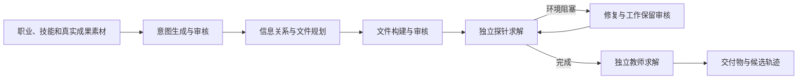

# WorkFactory Pipeline

生成专业工作任务、配套文件环境与教师候选轨迹的独立复现实现。

## 流程



教师从干净环境开始，只使用冻结后的任务材料。候选轨迹保留完整调用记录，人工验收和训练就绪状态单独记录。

## 快速开始

需要 Python 3.9 或更新版本、Docker Engine、外部模型凭据。所有命令在仓库根目录执行。

```bash
python3 -m workfactory --help
python3 -m unittest discover -s tests -v
docker build -t workfactory/runtime:v2 docker
python3 -m workfactory check-environment
```

按 [运行指南](docs/USAGE.md) 准备来源池后，启动一个批次。

```bash
python3 -m workfactory generate \
  --config /absolute/path/credentials.env \
  --pipeline-config config/pipeline.json \
  --output runs/batch-001 \
  --model gpt-6.1-sol
```

密钥保存在仓库外。任务并发、API 并发、阶段模型和容器资源由配置控制。

## 仓库导航

| 路径 | 内容 |
|---|---|
| `workfactory/pipeline/` | 任务编排、环境检查、修复与多模型批次 |
| `workfactory/sources/` | 职业池、技能采集与联网来源准备 |
| `workfactory/models/` | 模型接口、Responses 适配与 API 限流 |
| `workfactory/runtime/` | Agent 工具循环、Docker 与运行前检查 |
| `workfactory/tools/` | 文档、演示文稿与工作簿工具 |
| `workfactory/reporting/` | 批次报告与轨迹导出 |
| `workfactory/operations/` | macOS 后台服务 |
| `workfactory/core/` | 配置加载、阶段契约与校验 |
| `workfactory/experiments/` | 早期试验和回归入口 |
| `prompts/` · `schemas/` | 各阶段提示词与结构约束 |
| `config/` · `resources/` | 示例配置与固定来源快照 |
| `scripts/` · `tests/` | 运维辅助脚本与测试 |
| `docs/` | 架构、运行指南、实现状态与历史记录 |

## 常用命令

统一入口为 `python3 -m workfactory`，每个子命令均可加 `--help`。

| 子命令 | 用途 |
|---|---|
| `sources` | 采集来源并生成候选输入 |
| `generate` · `run-models` | 单模型或多模型批量生成 |
| `service` | macOS 后台启动、查询与停止 |
| `report` · `audit` · `watch` | 查看保存的状态、用量与进度 |
| `export` · `resume` | 导出候选轨迹或恢复指定任务 |
| `prepare-mixed` | 准备职业与技能混合输入 |
| `check-environment` · `check-sources` | 验证环境或来源到意图的生成 |

## 文档

- [架构与代码导航](docs/ARCHITECTURE.md)
- [安装、来源准备、运行与恢复](docs/USAGE.md)
- [旧命令迁移](docs/MIGRATION.md)
- [实现状态与验证边界](docs/IMPLEMENTATION_STATUS.md)
- [来源池统计](docs/SOURCE_POOL_STATISTICS.json)

仓库记录已有三条 GPT 混合来源任务完成执行并导出候选轨迹，人工验收与训练数据整理尚未统一完成。最新格式规划规则尚待新批次验证。此次目录整理保留现有生成、检索与审核策略。
