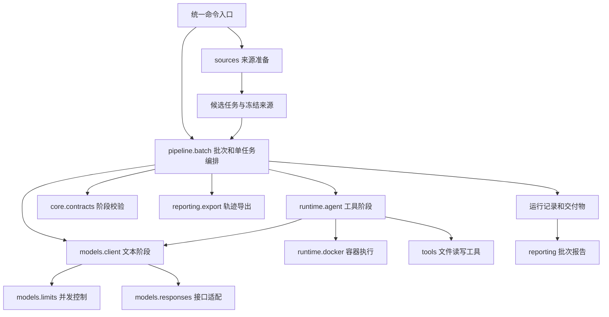

# 架构与代码导航

## 从哪里开始读

先读 `workfactory/pipeline/batch.py` 的 `attempt()`，它连接单个任务的主要阶段。再读 `materialize()` 查看实际文件如何构建。`run_case()` 管理尝试、来源准备与恢复，`main()` 管理批次并发。

## 阶段与实现

| 环节 | 实现位置 | 提示词 |
|---|---|---|
| 职业、技能与成果输入 | `sources/pools.py` · `sources/skills.py` · `sources/retrieval.py` | 来源准备有独立检索要求 |
| 意图生成 | `models/client.py` 的 `run_stage()` | `01a_occupation` · `01b_skill` · `01c_deliverable` |
| 意图审核 | `pipeline/batch.py` 的 `attempt()` | `02_intent_review` |
| 信息与文件规划 | 同上 | `03_plan` |
| 构建与内容审核 | `pipeline/batch.py` 的 `materialize()` | `04_build` · `05_construction_review` |
| 独立探针 | `pipeline/batch.py` 的 `attempt()` | `06_probe` |
| 修复与工作保留审核 | 同上 | `07_repair` · `08_preservation_review` |
| 教师求解 | 同上 | `09_teacher` |
| 轨迹导出 | `reporting/export.py` | 无 |

表内代码路径均相对 `workfactory/`，提示词位于根目录 `prompts/`，对应 JSON 契约位于 `schemas/`。

## 模块如何连接

## 目录边界

- `core` 提供共享配置与契约，业务编排放在 `pipeline`。
- `models` 负责请求、响应和限流，`runtime` 负责工具执行与沙箱。
- `sources` 准备构造素材，联网仅在配置启用后执行。
- `experiments` 保留早期试验入口，其中部分依赖历史运行目录。正式批次使用统一入口。
- `scripts` 保存检查、审计和恢复辅助命令，`docs/history` 保存历史记录。

## 文件与运行位置

来源快照、配置、提示词和测试数据的根目录仍为当前仓库。运行输出继续写入命令指定的目录，状态文件和轨迹结构保持原样。源码哈希记录使用整理后的路径。

工具进程、轨迹导出子进程、多模型子进程和 launchd 服务已同步更新入口。目录整理后的代码应使用新的批次目录，历史记录保留原样。

目录组织参考了 Terminal-Bench 将主包、测试与辅助脚本分开的方式。

[Terminal-Bench 仓库](https://github.com/harbor-framework/terminal-bench-1)
